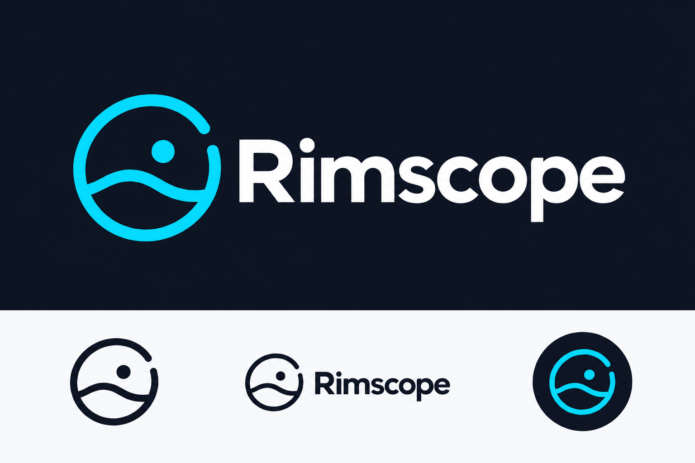

<p align="center">
  
</p>

# Rimscope · PHP2Shell Check

**Comprendre la technologie, l’intelligence artificielle et la cybersécurité, simplement.**
Rimscope partage des explications accessibles, notamment en hassaniya, et des outils
pratiques pour accompagner ses vidéos.

Cet outil aide à vérifier une version PHP et à savoir quoi contrôler face à PHP2Shell.
**Python 3.10 ou plus récent. Aucun module à installer.**

```bash
python3 check.py https://ton-site.com
```

Sur Windows : `py -3 check.py https://ton-site.com`.

**[Utilisation, résultats et mise à jour → GUIDE.md](GUIDE.md)**

L’outil consulte les en-têtes HTTP, sans tenter d’exploiter la faille. Il ne peut pas
certifier qu’un site est vulnérable ou sécurisé. Une version masquée donne un résultat
indéterminé ; les correctifs fournis par les distributeurs doivent être vérifiés chez eux.

Projet éducatif indépendant. Références vérifiées le **23 octobre 2026** :
[PHP](https://www.php.net/) ·
[avis CVE-2026-109618](https://github.com/php/php-src/security/advisories/GHSA-w8hw-w9fx-j79w) ·
[avis CVE-2026-109619](https://github.com/php/php-src/security/advisories/GHSA-6wmf-4rv5-p3rp).
